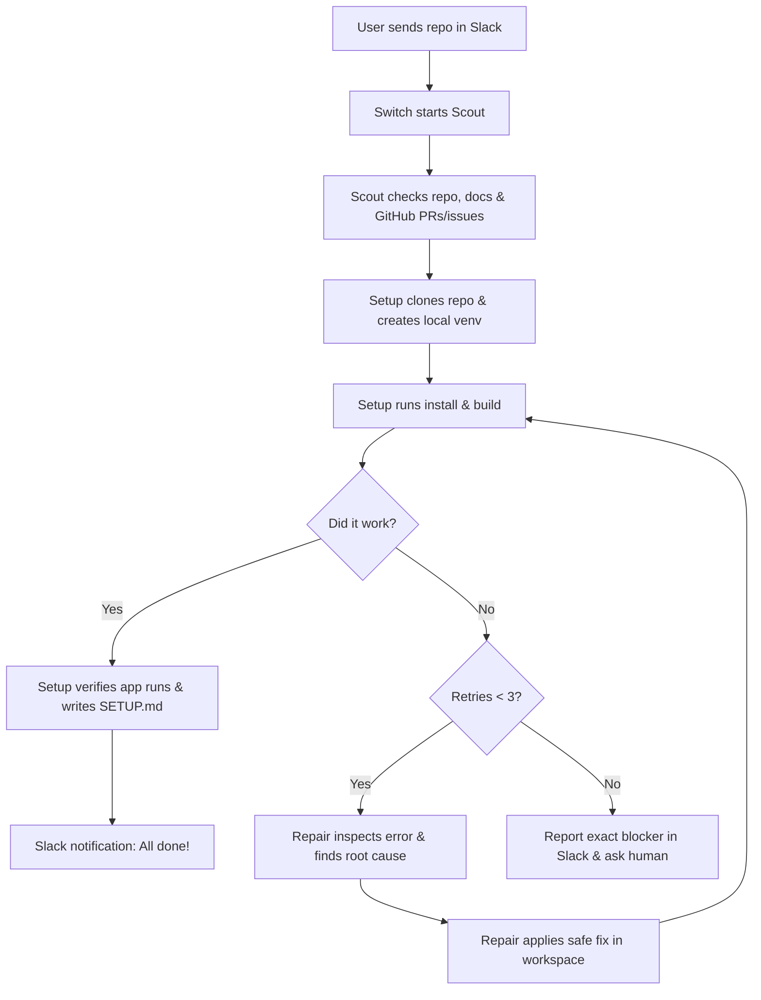

# Setup Desk

> **Your AI assistant for setting up open-source projects without the headache.**

Built for the **Flip the Switch Hackathon** (WeMakeDevs × DevTools Academy × Switch)  
**Track:** Business Workflow  
**Core Tool:** [Switch](https://github.com/sandbox-quantum/switch) multi-agent orchestration  

---

## Why I Built This (The Real Story)

During this hackathon, I tried setting up Switch locally on Windows. The Antigravity integration refused to work. I spent two hours checking paths, tweaking settings, and digging through logs. 

Finally, I messaged the maintainer—and found out the exact fix was already sitting in an open pull request.

That happens constantly in open source:
- Readmes are outdated or missing steps.
- Dependencies break on Windows or macOS.
- Build commands fail with cryptic errors.
- **Someone already solved your problem in an issue or PR, but you waste hours before finding it.**

Setup Desk fixes this. Instead of fighting broken setup scripts yourself, you send a repo link in Slack, and three AI agents handle the investigation, installation, and error recovery for you.

---

## How It Works

You post a repo link in Slack. Switch coordinates three agents in a room:

```
[ Developer in Slack ]
         │
         ▼
    [ Switch ]
         │
    ┌────┴──────────────────────────┐
    ▼                               ▼
 [ Scout ]                    [ Setup ] ◄───┐
 (Gathers intel & PR fixes)   (Installs &   │ (Max 3 retries)
                              verifies app) │
                                    │       │
                              Error?│       │
                                    ▼       │
                                [ Repair ] ─┘
                                (Finds root cause
                                 & applies safe fix)
```

1. **Scout** checks the repo, docs, and public GitHub issues/PRs for known setup gotchas *before* running anything. (Read-only)
2. **Setup** clones the repo into a clean local workspace, sets up a virtual environment, installs dependencies, and actually runs/tests the app to make sure it works.
3. **Repair** kicks in if something fails. It looks at the error trace, finds a safe local fix (like relaxing an outdated version pin or creating a `.env`), patches the file, and hands control back to Setup to retry.

Setup Desk stops after **3 repair attempts** so it never gets stuck in an infinite loop. When finished, Setup creates a clean `SETUP.md` with instructions that actually worked.

---

## The Self-Healing Workflow

The core feature of Setup Desk is the self-healing retry loop:



---

## The Three Agents

| Agent | What it does | Permissions |
|---|---|---|
| [**Scout**](agents/scout.md) | Reads README, structure, dependencies, and GitHub issues/PRs for known bugs. | **Read-only**. Never touches code or runs commands. |
| [**Setup**](agents/setup.md) | Clones repo, sets up local venv, installs dependencies, runs tests, and verifies app execution. Generates `SETUP.md`. | **Local workspace only**. Never uses sudo or global packages. |
| [**Repair**](agents/repair.md) | Diagnoses failures, applies targeted fixes to local files, and hands back to Setup (up to 3 tries). | **Local workspace only**. Safe edits only. |

Full specs are in the [`agents/`](agents/README.md) folder.

---

## Why Switch?

Switch is what makes this a real workflow instead of a single brittle prompt:
- **Shared Room Context:** Scout, Setup, and Repair share execution history, error logs, and findings in one place without losing context.
- **Event-Driven Handoffs:** Switch triggers Setup when Scout finishes, and routes straight to Repair if Setup fails.
- **Loop Enforcement:** Switch enforces our 3-attempt safety limit so agents never run wild.
- **Slack Gateway:** Connects real developer chat directly to the agents.

---

## Tech Stack

We kept it simple and didn't invent fake tools:
- **Orchestration:** [Switch](https://github.com/sandbox-quantum/switch)
- **User Interface:** Slack
- **Agent Models:** Codex and OpenCode backends connected via Switch
- **Target Environment:** Local project workspace (isolated `.venv`)
- **Intelligence:** GitHub docs, issues, and PRs

*No custom frontend or database needed—Slack is the interface, Switch is the brain.*

---

## Quick Example (Setting up Flask)

Here's what a real run looks like:

1. **You ask in Slack:**  
   `@SetupDesk Set up https://github.com/pallets/flask in my workspace. Check known issues first, install, run tests, and fix any safe setup errors.`
2. **Scout reports:** Python 3.9+ project using `flit_core`. Flags that on Python 3.11+, an older pinned dev dependency might cause pip resolution errors.
3. **Setup runs:** Clones repo, builds `.venv`, runs `pip install -e .[dev]`. It hits the version conflict Scout flagged!
4. **Repair fixes it:** Checks the error log, relaxes the pinned version in `pyproject.toml` to a compatible one, and hands back to Setup.
5. **Setup verifies:** Re-runs pip (passes), runs `pytest` (passes), runs `flask --help` (verified).
6. **Result in Slack:** Setup generates a clean `SETUP.md` and posts: *"Flask is ready to run!"*

See the full example logs:
- [Sample Slack Request](examples/sample-request.md)
- [Scout Report Example](examples/scout-report.md)
- [Setup Execution Log](examples/setup-report.md)
- [Repair Patch Report](examples/repair-report.md)

---

## Safety First

Setup Desk is built with clear safety rules:
- **Everything stays in the workspace folder.** Agents cannot touch files outside it.
- **No sudo, no admin, no global installs.** All packages go into local virtual environments (`.venv`).
- **No touching credentials.** Agents cannot read SSH keys, `.env` secrets, or tokens.
- **Max 3 repair tries.** If it can't fix an issue in 3 attempts, it stops and asks you.

*(Note: Agent prompts alone don't replace security. Switch and the connected agent sandbox enforce actual execution limits. See [Safety Model](docs/safety-model.md).)*

---

## Demo & Hackathon Links

- **Demo Video:** `[Add link to your 2-3 min video]`
- **Video Script:** Check out [`demo/demo-script.md`](demo/demo-script.md) for a ready-to-record 2–3 minute script.
- **Screenshots:** Drop your screenshots in [`demo/screenshots/`](demo/screenshots/README.md).

---

## Repository Guide

- [`agents/`](agents/README.md): Detailed prompts and rules for Scout, Setup, and Repair.
- [`workflows/`](workflows/README.md): The standard setup path and the self-healing retry loop.
- [`docs/`](docs/): Architecture overview, getting started guide, tech stack, and design decisions.
- [`examples/`](examples/README.md): Step-by-step example showing Flask setup and repair.
- [`demo/`](demo/README.md): Demo script and screenshot checklist.
