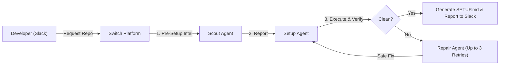
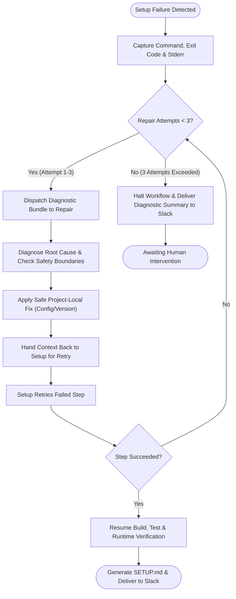
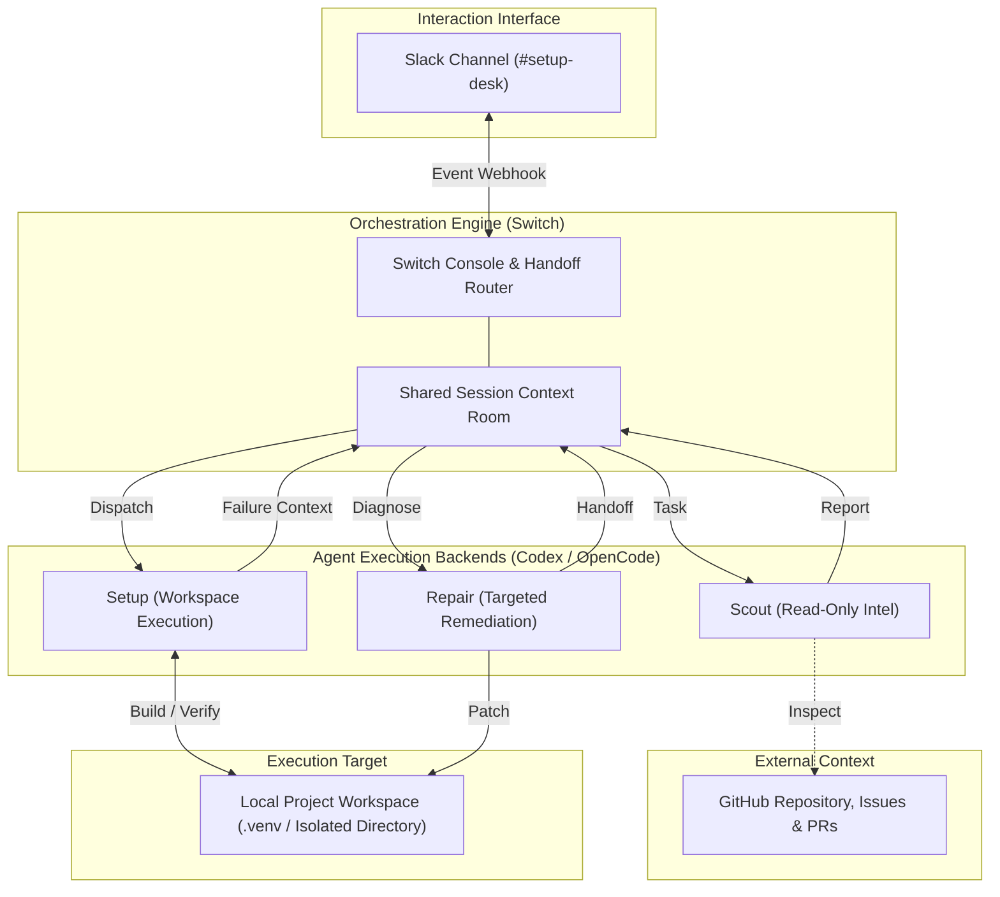

# Setup Desk

> **Your AI-powered assistant for setting up open-source projects.**

[](https://github.com/sandbox-quantum/switch)
[](#hackathon-context)
[](https://github.com/sandbox-quantum/switch)

Setup Desk is a multi-agent workflow that investigates open-source repositories, handles local setup, and attempts to recover from setup failures automatically. 

Orchestrated using [Switch](https://github.com/sandbox-quantum/switch) and interacting through **Slack**, Setup Desk coordinates three specialized agents powered by **Codex** and **OpenCode** to turn what is often hours of setup frustration into a reliable, self-healing workflow.

---

## Table of Contents

- [Hackathon Context](#hackathon-context)
- [The Problem](#the-problem)
- [Personal Motivation](#personal-motivation)
- [The Solution](#the-solution)
- [Why Switch?](#why-switch)
- [How Setup Desk Works](#how-setup-desk-works)
- [The Three Agents](#the-three-agents)
- [The Self-Healing Workflow](#the-self-healing-workflow)
- [System Architecture](#system-architecture)
- [Technology Stack](#technology-stack)
- [Key Features](#key-features)
- [Example Use Case: Setting Up Flask](#example-use-case-setting-up-flask)
- [Sample Slack Request](#sample-slack-request)
- [Demo Video & Screenshots](#demo-video--screenshots)
- [Getting Started](#getting-started)
- [Safety Model & Controlled Autonomy](#safety-model--controlled-autonomy)
- [Current Limitations](#current-limitations)
- [Future Improvements](#future-improvements)

---

## Hackathon Context

- **Event**: [Flip the Switch Hackathon](https://github.com/sandbox-quantum/switch)
- **Organizers**: [WeMakeDevs](https://wemakedevs.org/) × [DevTools Academy](https://devtoolsacademy.com/) × [Switch](https://github.com/sandbox-quantum/switch)
- **Track**: Business Workflow
- **Core Platform**: [Switch](https://github.com/sandbox-quantum/switch) (Open-source multi-agent orchestration platform)

Setup Desk was conceived and submitted as an enterprise developer productivity solution, demonstrating how Switch coordinates specialized AI agents to solve one of software engineering's most universal bottlenecks: local developer environment onboarding.

---

## The Problem

Developers frequently struggle when attempting to run unfamiliar open-source projects locally:

1. **Incomplete or Outdated Documentation**: Readmes often lag behind fast-moving codebases, omitting critical setup steps or configuration flags.
2. **Missing System Prerequisites**: Toolchain dependencies, compilers, or specific language runtimes are frequently undocumented.
3. **Operating System Incompatibilities**: A setup script written for Linux often fails silently or errors out on Windows or macOS.
4. **Fragile Build & Dependency Commands**: Dependency conflicts, broken wheels, and deprecated package distributions cause installs to abort.
5. **Buried Community Solutions**: Solutions to known setup blockers often already exist in closed issues, active pull requests, or obscure discussion threads, but developers waste hours troubleshooting before discovering them.

This friction leads to abandoned open-source evaluations, delayed onboarding for contributors, and wasted engineering hours.

---

## Personal Motivation

The motivation behind Setup Desk came directly from personal experience during this hackathon.

While attempting to install and run Switch on Windows, I encountered an issue where the Antigravity integration failed to function properly. I spent significant time debugging environment configurations, searching for missing libraries, and troubleshooting locally. 

Eventually, after contacting the project maintainer, I learned that the exact issue was already being resolved in an open pull request.

That experience demonstrated a fundamental reality: **developers repeatedly waste time troubleshooting problems that already have known solutions simply because they do not know where to look.**

Setup Desk was built to eliminate that gap by pairing pre-setup repository intelligence with automated, safe self-healing.

---

## The Solution

Setup Desk acts as an autonomous setup assistant. Instead of manually parsing documentation, scouring GitHub issues, provisioning virtual environments, and debugging stack traces, a developer simply posts a setup request into a Slack channel.

Switch coordinates three specialized agents:
- **Scout**: Investigates the repository and community signals before anything is executed.
- **Setup**: Provisions an isolated local workspace, installs dependencies, and verifies runtime execution.
- **Repair**: Investigates runtime failures, pinpoints root causes, and applies safe project-local fixes.

The agents collaborate within a shared Switch room and communicate through structured handoffs.

> [!NOTE]
> Setup Desk is an orchestration workflow, not a standalone web application. Its user interaction interface is **Slack**, its control plane is **Switch Console**, and its reasoning is driven by **Codex** and **OpenCode**.

---

## Why Switch?

[Switch](https://github.com/sandbox-quantum/switch) is the central orchestration backbone of Setup Desk. Coordinating multiple AI agents across an interactive workflow requires more than chained API calls:

- **Unified Context Room**: Switch provides a persistent execution room where Scout's pre-setup findings, Setup's execution traces, and Repair's diagnostic fixes are maintained without context fragmentation.
- **Stateful Agent Handoffs**: Setup Desk relies on event-driven handoffs—transitioning from Scout to Setup upon report completion, and shifting to Repair only when an execution error occurs.
- **Enforcing Bounded Retries**: Switch enforces the workflow boundary of a maximum of three repair iterations, terminating cleanly if an issue requires human intervention.
- **Slack Gateway**: Switch provides the bridge connecting developer chat in Slack to the autonomous multi-agent backend.

---

## How Setup Desk Works



1. **Request**: The developer submits a setup command in Slack with the repository URL and target preferences.
2. **Investigation**: Scout inspects the repository structure, documentation, and public issues/PRs in a read-only mode.
3. **Execution**: Setup provisions an isolated local environment, installs dependencies, and tests runtime execution.
4. **Self-Healing (if needed)**: If a failure occurs, Repair diagnoses the error, applies a safe workspace fix, and returns control to Setup for verification (up to 3 attempts).
5. **Delivery**: Setup generates a verified `SETUP.md` document and reports the result back to Slack.

---

## The Three Agents

Setup Desk enforces strict separation of concerns across its three agents:

| Agent | Core Purpose | Permissions | Detailed Spec |
|---|---|---|---|
| **Scout** | Gathers repository intelligence, examines manifests, checks documentation, and searches public GitHub issues/PRs for known setup blockers before commands run. | **Read-Only** | [agents/scout.md](agents/scout.md) |
| **Setup** | Clones the repository into an isolated workspace, provisions project-local virtual environments, installs dependencies, runs build/tests, and verifies runtime stability. Generates `SETUP.md`. | **Workspace Execute / Write** | [agents/setup.md](agents/setup.md) |
| **Repair** | Receives diagnostic failure bundles from Setup, analyzes stack traces against known community fixes, applies project-local remediations, and hands back for retry. | **Workspace Write** (Max 3 retries) | [agents/repair.md](agents/repair.md) |

For complete role definitions and handoff contracts, see [`agents/README.md`](agents/README.md).

---

## The Self-Healing Workflow

The self-healing recovery loop is the primary differentiator of Setup Desk. Rather than crashing or requiring manual developer debugging, Setup Desk diagnoses and remediates common setup friction autonomously within strict safety boundaries.



> [!IMPORTANT]
> **Defensive Bounded Autonomy**  
> The self-healing workflow is explicitly bounded to a **maximum of three repair attempts per failure sequence**. Setup Desk never enters recursive or infinite repair loops. If an error persists after three attempts, the system halts and escalates to the developer with full diagnostic context.

For a full sequence diagram and trigger specifications, see [`workflows/self-healing-workflow.md`](workflows/self-healing-workflow.md).

---

## System Architecture



For complete architectural details, see [`docs/architecture.md`](docs/architecture.md).

---

## Technology Stack

Setup Desk relies exclusively on the following core technologies:

- **Multi-Agent Orchestration**: [Switch](https://github.com/sandbox-quantum/switch)
- **User Interaction**: Slack
- **Agent Backends**: Codex and OpenCode
- **Repository Intelligence**: GitHub (Public Documentation, Issues, Pull Requests)
- **Target Environment**: Local Sandboxed Project Workspace

*Note: Setup Desk does not employ custom web frameworks, proprietary databases, or standalone backend servers. For details, see [`docs/technology-stack.md`](docs/technology-stack.md).*

---

## Key Features

- **Pre-Setup Repository Intelligence**: Scout flags OS incompatibility, missing toolchains, and community-reported bugs before any code is run.
- **Closed-Loop Self-Healing**: Automatically catches build and dependency errors, isolates root causes, applies targeted fixes, and retries.
- **Bounded Autonomous Retries**: Caps repair attempts at 3 per sequence, preventing runaway loops or unintended modifications.
- **Runtime Execution Verification**: Never claims success based solely on package installation; verifies compilation, tests, and active application boot.
- **Automatic `SETUP.md` Authoring**: Creates a clean, audited, and reproducible setup guide inside the repository for the team.
- **Slack-Native Interface**: Works where developers already communicate, requiring no new web portals.
- **Strict Workspace Containment**: Restricts all modifications strictly to the assigned workspace directory without administrative privilege escalation.

---

## Example Use Case: Setting Up Flask

To illustrate the multi-agent workflow, consider an onboarding developer requesting the setup of [`pallets/flask`](https://github.com/pallets/flask):

1. **Request**: Developer posts in `#setup-desk` requesting Flask setup.
2. **Scout Analysis**: Scout reviews `pyproject.toml`, detects Python $\ge$ 3.9 and `flit_core`, and checks public issue threads for Python 3.11 compatibility considerations.
3. **Setup Execution**: Setup clones the repository and provisions `.venv`. During `pip install -e .[dev]`, an outdated optional documentation dependency causes a resolution error.
4. **Repair Remediation**: Repair analyzes the trace, relaxes the patch-level dependency constraint in the workspace file, and returns context to Setup.
5. **Setup Verification**: Setup retries installation (succeeds), runs `pytest` (passes), verifies `flask --help` runtime, and authors `SETUP.md`.

Explore the complete illustrative artifacts:
- [Sample Slack Request](examples/sample-request.md)
- [Illustrative Scout Report](examples/scout-report.md)
- [Illustrative Setup Report](examples/setup-report.md)
- [Illustrative Repair Report](examples/repair-report.md)

---

## Sample Slack Request

```text
@SetupDesk Set up https://github.com/pallets/flask in my workspace. Investigate known setup issues first, install dependencies, run the project, and recover from safe setup failures if necessary.
```

---

## Demo Video & Screenshots

### Demonstration Video
- A 2–3 minute video presentation and walkthrough is scripted in [`demo/demo-script.md`](demo/demo-script.md).
- *Video link placeholder*: `[Watch Demo Video on YouTube / Submission Portal]`

### Screenshots
Visual walkthroughs and interface captures are cataloged in [`demo/screenshots/`](demo/screenshots/README.md).
- `01-slack-setup-request.png` — Developer request in Slack.
- `02-scout-investigation.png` — Scout repository intelligence report.
- `03-setup-execution.png` — Setup agent creating the isolated environment.
- `04-setup-failure.png` — Execution error captured by Setup.
- `05-repair-diagnosis.png` — Repair agent root-cause diagnosis.
- `06-successful-retry.png` — Setup re-running and verifying tests.
- `07-generated-setup-md.png` — Verified `SETUP.md` document delivered to Slack.

---

## Getting Started

Because Setup Desk is configured and orchestrated via the Switch platform:

1. Connect your **Codex** and **OpenCode** backends in Switch.
2. Import the agent specifications from the [`agents/`](agents/README.md) directory.
3. Bind your Switch Room to your team's Slack channel.
4. Define your local workspace execution directory.

For a step-by-step checklist, see [`docs/getting-started.md`](docs/getting-started.md).

---

## Safety Model & Controlled Autonomy

Setup Desk adheres to strict controlled autonomy principles:
- **Autonomous Scope**: Cloning into isolated workspace, provisioning project-local virtual environments, running project tests, and modifying local configs.
- **Strictly Prohibited**: Administrative privileges (`sudo`/root), global environment modification, altering files outside the workspace directory, accessing secrets or private credentials, and destructive system commands.
- **Platform Authority**: Agent prompts alone do not enforce security. Sandboxing and permission restrictions enforced by Switch and the connected Codex/OpenCode backends remain authoritative.

For full safety details, see [`docs/safety-model.md`](docs/safety-model.md).

---

## Current Limitations

- **Slack Dependency**: Requires Slack for user interaction and trigger ingestion.
- **No System-Level Toolchain Provisioning**: Cannot autonomously install missing system compilers (`gcc`, `cmake`) or OS packages requiring administrative privileges.
- **3-Attempt Cap**: Complex setup failures requiring manual architectural refactoring will halt after three iterations.

For complete transparency, read [`docs/limitations-and-future-work.md`](docs/limitations-and-future-work.md).

---

## Future Improvements

- Containerized sandboxing via disposable Docker / Podman runners.
- Broader ecosystem support (Rust `cargo`, Go `go mod`, monorepo build tools).
- Repository setup compatibility scoring.
- Persistent community setup knowledge base.
- Standalone optional web dashboard.

*Note: Future ideas are roadmapped concepts, not implemented features. See [`docs/limitations-and-future-work.md`](docs/limitations-and-future-work.md).*

