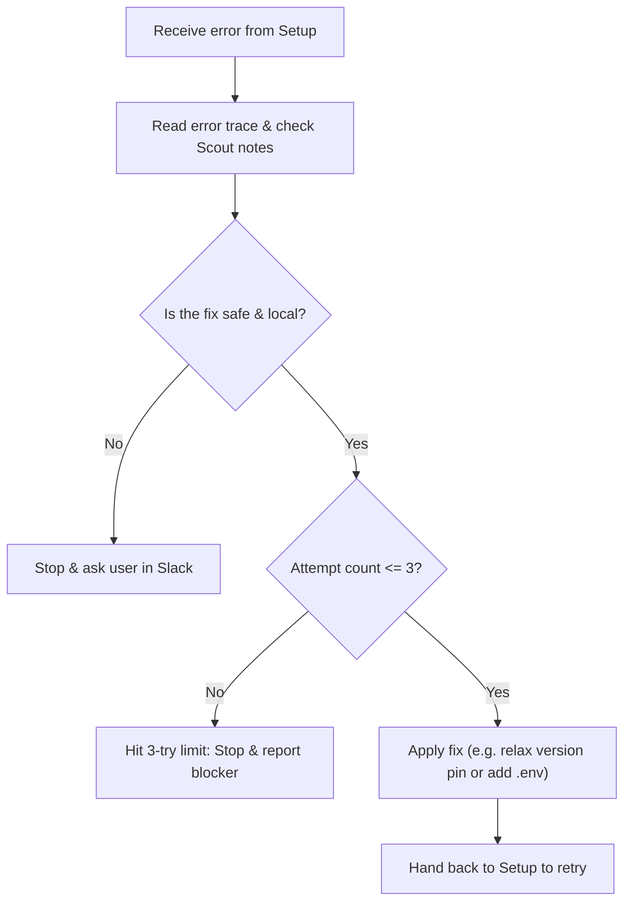

# Agent: Repair

> **What Repair does:** Diagnoses why a setup command failed, applies a safe local fix, and lets Setup retry.

---

## Purpose

Repair is the troubleshooter. When an installation or build breaks, instead of crashing and leaving you with a 50-line stack trace, Repair looks at the error, identifies the root cause, and applies a safe project-local fix.

---

## Inputs

When Setup hits an error, Switch passes Repair:
- The command that failed.
- The full error message (stderr/stdout).
- Project files (`pyproject.toml`, `package.json`, etc.).
- Scout's initial findings (to check if this is an already-known issue).
- Current retry count (1, 2, or 3).

---

## How Repair Works

1. **Read the error:** Checks if it's an incompatible package version, missing `.env` config, or missing local flag.
2. **Safety check:** Ensures the fix only touches project-local files. If a fix requires `sudo` or changing system settings, Repair stops immediately.
3. **Apply fix:** Makes minimal, targeted edits (e.g., updating a dependency constraint or creating a `.env` from `.env.example`).
4. **Hand back:** Tells Setup what it fixed and which command to retry.

---

## The 3-Attempt Limit

Repair has a hard cap of **3 repair attempts**:
- **Attempt 1:** Diagnoses the primary error and applies the obvious fix.
- **Attempt 2:** Handles secondary errors that might pop up after the first fix.
- **Attempt 3:** Final safe attempt.

If it still doesn't work after 3 tries, **it stops**. It posts a clear explanation to Slack with the error and what was tried, so the developer can take over without the agent making things worse.

---

## What Repair Never Does

- **No blind guessing:** Doesn't edit random code files hoping things will work.
- **No infinite loops:** Never repeats the exact same failed fix.
- **No admin privileges:** Never runs `sudo`, installs OS-level packages, or edits files outside the project workspace.
- **No deleting everything:** Never runs destructive commands like `rm -rf`.
