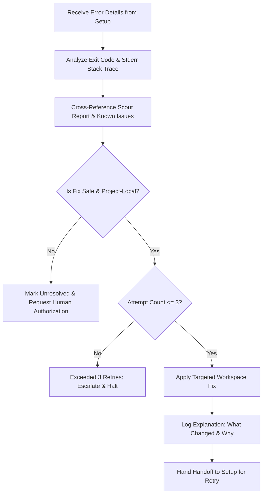

# Agent: Repair

> **Role Summary**: Diagnoses setup failures, applies safe fixes and helps Setup retry until it works.

---

## Purpose

The **Repair** agent is Setup Desk's self-healing specialist. When the [Setup](setup.md) agent encounters a compilation error, missing module, version mismatch, or runtime configuration failure, Repair intervenes. Rather than abandoning the setup process or asking the user to manually decipher complex stack traces, Repair diagnoses the error, determines the root cause, applies a safe, targeted project-local fix, and passes control back to Setup.

---

## Inputs

Repair receives comprehensive diagnostic context from Setup via the Switch room:

- **Failed Command**: The exact command line string that produced the failure.
- **Error Logs**: Full captured stdout and stderr outputs.
- **Target Repository State**: Path to the repository and relevant manifest files (`pyproject.toml`, `requirements.txt`, `package.json`, etc.).
- **Scout Intelligence**: The initial report from [Scout](scout.md), including any known issues or PRs that might match the failure.
- **Attempt History**: The sequence of previous attempts, failures, and fixes during the current session.

---

## Diagnosis & Investigation Protocol

Repair follows an evidence-based diagnosis workflow:



### 1. Root-Cause Isolation
- Inspects stderr logs to differentiate between missing build dependencies, pinned version incompatibilities, missing configuration files, or platform-specific syntax.
- Compares error signatures against known public issues identified by Scout or standard package management troubleshooting patterns.

### 2. Safety & Scope Assessment
- Evaluates whether the proposed remediation can be executed strictly inside the project directory.
- Rejects remedies that require system-level package managers (`apt`, `brew`, `choco`), elevated privileges (`sudo`), or changes to global OS settings.

### 3. Targeted Remediation
- Applies minimal, transparent changes:
  - Adjusting a pinned dependency version in a requirements file or lockfile.
  - Creating a missing `.env` from an existing `.env.example` template with default values.
  - Supplying missing build flags or invoking a compatibility shim within the virtual environment.

### 4. Transparent Explanation & Handoff
- Formats a clear repair log documenting:
  - Identified root cause.
  - Specific files or configurations modified.
  - Justification for the change.
- Transmits the updated state back to Setup to initiate a retry.

---

## The 3-Attempt Retry Boundary

> [!IMPORTANT]
> **Defensive Retry Boundary: Maximum 3 Repair Attempts**
> Setup Desk strictly enforces a limit of **three repair cycles per failure sequence**.
>
> - **Attempt 1**: Initial error diagnosed and addressed with primary remediation.
> - **Attempt 2**: Secondary adjustment if alternative blocker surfaces.
> - **Attempt 3**: Final fallback attempt within project-local boundaries.
>
> If the setup still fails after the third repair attempt, Repair **halts immediately**, declares the issue unresolved, and outputs a clear diagnostic summary to Slack. It never loops infinitely or repeatedly applies the same failed fix.

---

## What Repair Never Does

To prevent repository corruption and maintain system integrity, Repair adheres to strict prohibitions:

1. **No Blind Edits**: Never guesses or modifies arbitrary source files without clear diagnostic evidence from error traces.
2. **No Repetitive Loops**: Never reapplies an identical fix that has already failed during the session.
3. **No Unsafe Escalation**: Never attempts to bypass permissions, disable security features, or invoke global administrative commands.
4. **No Destructive Overwrites**: Keeps backups or tracks modified files so changes can be audited or reverted.

---

## Deliverables & Handoff Contract

Upon applying a safe fix, Repair issues a structured handoff message in the Switch room:

```markdown
# Repair Remediation Report

- **Failure Type**: [e.g., Dependency Conflict / Missing Config / Build Error]
- **Root Cause**: [Detailed explanation of why the command failed]
- **Changes Applied**:
  - Modified: `requirements.txt` (adjusted `package-x` from `==1.0.0` to `>=1.0.1`)
- **Attempt Count**: [e.g., Attempt 1 of 3]
- **Instructions to Setup**: [Retry command: `pip install -e .`]
```

Control then returns to the Setup agent to re-run and verify the failed step.

