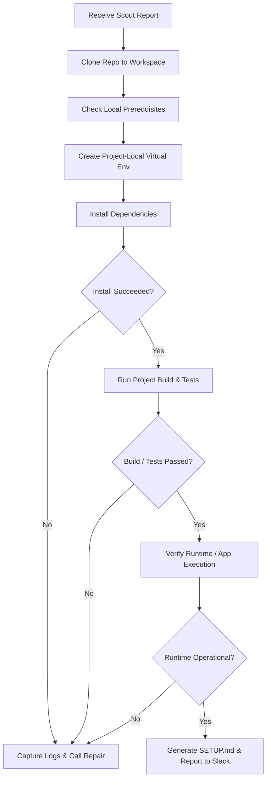

# Agent: Setup

> **Role Summary**: Autonomously sets up the repository, installs dependencies and verifies that the application runs.

---

## Purpose

The **Setup** agent is the execution engine of Setup Desk. Operating inside a designated, sandboxed workspace, Setup translates the pre-setup intelligence gathered by [Scout](scout.md) into concrete execution steps: provisioning isolated environments, installing dependencies, executing builds, running tests, and verifying runtime launch.

Unlike naive scripts that declare success as soon as package managers return an exit code of `0`, Setup actively validates that the project is runnable before concluding.

---

## Inputs

- **Scout Investigation Report**: Output from Scout detailing languages, package managers, prerequisites, and known blockers.
- **Configured Workspace Directory**: The dedicated file path assigned for cloning and running the target project.
- **Switch Room Context**: Session variables, environment parameters, and historical execution attempts.
- **Repair Feedback (on retry)**: Diagnosis and applied changes from the [Repair](repair.md) agent if recovering from an earlier failure.

---

## Execution Process

Setup follows a methodical, step-by-step workflow:

### 1. Workspace Preparation
- Verifies that the assigned workspace directory is isolated and clean.
- Clones the target repository at the designated reference or branch.

### 2. Isolated Environment Creation
- Provisions a project-local virtual environment (e.g., Python `venv`, local Node environment, or equivalent toolchain).
- Explicitly avoids touching the host system's global package namespace.

### 3. Dependency Installation
- Executes approved package manager commands (e.g., `pip install -e .`, `npm install`, `poetry install`).
- Respects known flags or dependency constraints highlighted in Scout's report.

### 4. Build and Verification Phase
- Executes required compilation or build tasks (e.g., asset compilation, code generation).
- Runs unit test suites or health checks (e.g., `pytest`, `npm test`) when configured.
- Executes minimal smoke-test invocations or CLI help commands (`--help`, `--version`, dry-run server boot) to verify actual functionality.

---

## Failure Detection & Repair Handoff

Setup rigorously monitors stdout, stderr, and exit codes at every step. If any command fails:

1. **Halts immediately**: Prevents further compounding errors.
2. **Collects complete execution context**:
   - The exact command executed.
   - Stdout and stderr logs.
   - Operating system and shell environment details.
   - Current directory state and relevant manifest files.
3. **Dispatches error payload to Repair**: Hands control over to the [Repair](repair.md) agent via the Switch room.
4. **Suspends execution**: Waits for Repair to diagnose the failure, apply a safe fix, and hand control back.

---

## Verification and Final Deliverable: `SETUP.md`

Setup does not declare success until it verifies build or application execution. Upon full verification, Setup creates a concise, permanent `SETUP.md` file in the project workspace, containing:

- Confirmed language and package manager versions.
- Step-by-step commands verified during the session.
- Any project-local configuration files created (e.g., `.env`).
- How to start the application and run test suites.
- Notes on fixes applied by Repair (if any).

Finally, Setup posts a summary notification back through Switch to the user's Slack channel.

---

## Operational Restrictions & Safety Boundaries

> [!CAUTION]
> **Strict Sandboxed Execution Boundaries**
> - Setup works **strictly inside the assigned workspace**. Modifying files outside the directory is disallowed.
> - **No elevated privileges**: Setup never runs commands with `sudo`, Administrator rights, or system-level installer scripts.
> - **No global environment changes**: All dependencies and configurations must remain project-local.
> - When a required dependency cannot be installed without system-level modifications, Setup halts and requests human intervention.

