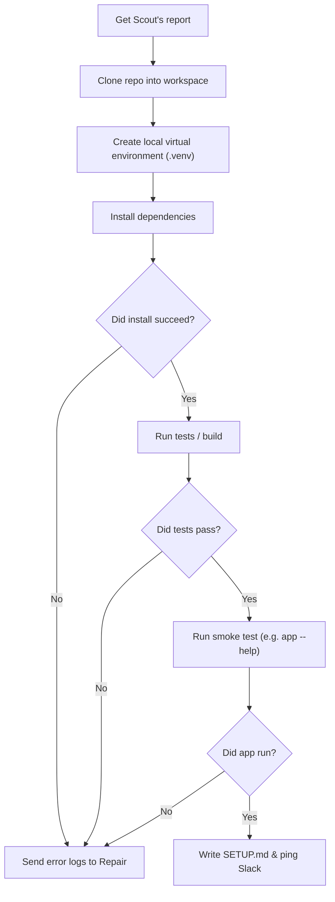

# Agent: Setup

> **What Setup does:** Sets up the repository, installs dependencies in an isolated virtual environment, and verifies that the app actually runs.

---

## Purpose

Setup does the heavy lifting. It takes Scout's report, clones the repository into a clean local folder, sets up a local virtual environment, installs the dependencies, and tests that the project actually runs.

Setup doesn't just install packages and call it a day—it runs tests or a quick CLI command to make sure the app really works before claiming success.

---

## Inputs

- **Scout Report:** Project info, prerequisites, and known gotchas from [Scout](scout.md).
- **Workspace Folder:** An isolated local directory where the code lives.
- **Repair Feedback (if retrying):** What [Repair](repair.md) changed and the command to retry.

---

## How Setup Works

### Steps:
1. **Clone repo:** Downloads the code into the assigned workspace folder.
2. **Create local environment:** Sets up a project-local virtual environment (e.g. Python `.venv` or local `node_modules`). It never touches your global system packages.
3. **Install packages:** Runs package manager commands (`pip install -e .`, `npm install`, etc.).
4. **Verify execution:** Runs unit tests (`pytest`, `npm test`) or launches the app with `--help` / dry run to verify it isn't broken.
5. **Write `SETUP.md`:** Generates a short, clear `SETUP.md` with the exact steps that succeeded.

---

## What happens when something fails?

If an install or test command throws an error:
1. Setup stops immediately so it doesn't make things worse.
2. It captures the exact command, exit code, and stdout/stderr.
3. It hands the failure info over to **Repair** via Switch.
4. Once Repair applies a fix, Setup re-runs the failed step to verify it works.

---

## Safety Rules

- **Workspace only:** Setup only runs commands inside the designated project directory.
- **No sudo / admin:** Setup never runs commands as administrator or root.
- **No global changes:** Dependencies are kept strictly inside the virtual environment.
- If a project requires a system-wide compiler or service that isn't installed, Setup stops and asks the user.
