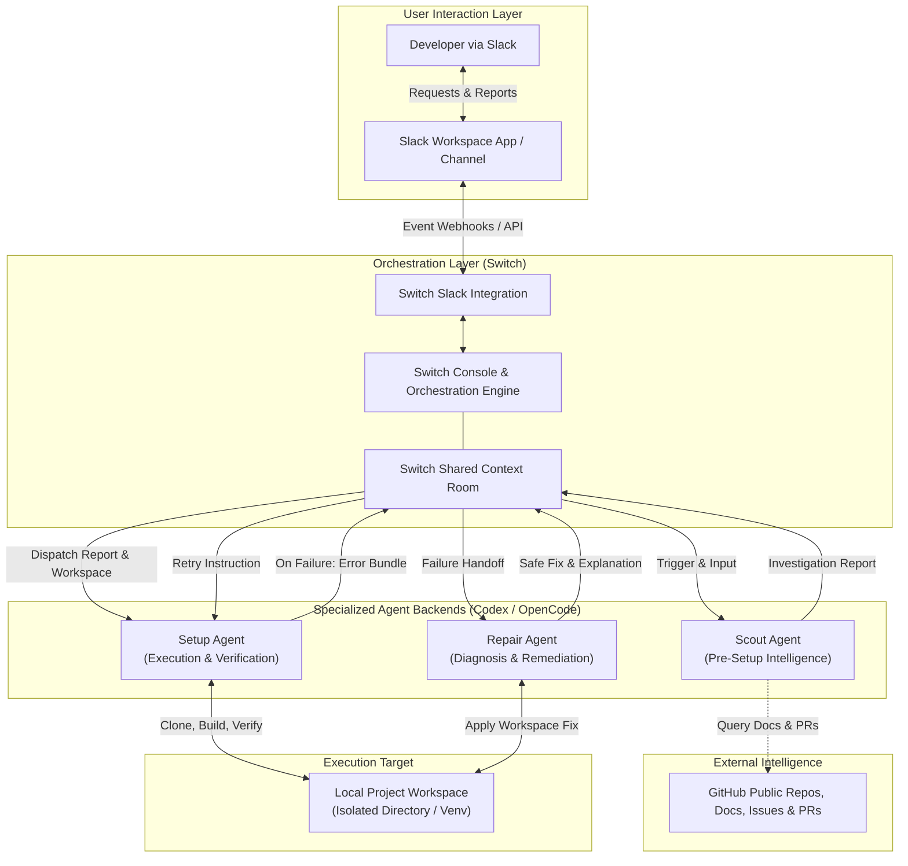

# System Architecture

Setup Desk is an agentic workflow architecture designed to automate local open-source project exploration, installation, runtime verification, and error remediation. Orchestrated using [Switch](https://github.com/sandbox-quantum/switch), the system uses Slack as its front-facing interface and coordinates specialized coding agents powered by Codex and OpenCode.

---

## Architectural Diagram

---

## Core Components and Roles

### 1. User Interaction Layer: Slack
Setup Desk does not feature a custom frontend web application. Instead, it embeds directly into existing developer workflows via Slack.
- **Request Ingestion**: Developers post setup requests (e.g., repository links, branch details, specific testing criteria) in designated Slack channels.
- **Progress Tracking & Final Delivery**: Status updates, diagnostic logs, and final setup deliverables (`SETUP.md`) are returned directly to the initiating Slack thread.

### 2. Multi-Agent Orchestration Layer: Switch
[Switch](https://github.com/sandbox-quantum/switch) acts as the central control plane and execution harness:
- **Session Management**: Initializes and manages the shared room context across the multi-agent session.
- **Handoff Coordination**: Controls the structured transitions:
  1. User request $\rightarrow$ Scout
  2. Scout report $\rightarrow$ Setup
  3. Setup failure $\rightarrow$ Repair
  4. Repair remediation $\rightarrow$ Setup retry
- **Execution State & Retry Enforcer**: Tracks attempt counts, strictly enforcing the maximum limit of three repair cycles per failure.

### 3. Agent Backends: Codex and OpenCode
The operational agents are powered by connected coding agent backends (Codex and OpenCode):
- **Codex / OpenCode**: Execute language comprehension, codebase inspection, command generation, and code/config editing within the designated execution environment.

### 4. Repository Intelligence: GitHub
Before running setup commands, Scout accesses public repository data:
- `README.md`, `CONTRIBUTING.md`, and project documentation.
- Package manifests (`pyproject.toml`, `package.json`, etc.).
- Public GitHub issues and pull requests containing known setup errors and community-tested solutions.

### 5. Target Environment: Local Project Workspace
The physical filesystem directory where repository files are cloned, environments are provisioned, and builds are verified.
- **Workspace Containment**: All file modifications and command executions are restricted strictly to this folder.

---

## Agent Handoffs and Data Flow Contracts

Setup Desk avoids ambiguous free-form agent chat by relying on well-defined contracts:

### Handoff 1: Request $\rightarrow$ Scout
- **Payload**: Repository URL, optional ref/branch, host OS information.
- **Contract**: Scout executes in read-only mode and compiles the *Scout Investigation Report*.

### Handoff 2: Scout $\rightarrow$ Setup
- **Payload**: Identified languages, runtimes, package managers, prerequisites checklist, step-by-step setup commands, and known blockers.
- **Contract**: Setup provisions the local workspace and executes commands sequentially.

### Handoff 3: Setup $\rightarrow$ Repair (On Failure)
- **Payload**: Failed command, stdout/stderr logs, current workspace file state, attempt count ($1 \le N \le 3$).
- **Contract**: Repair evaluates root cause and restricts modifications exclusively to workspace-local files.

### Handoff 4: Repair $\rightarrow$ Setup (On Remediation)
- **Payload**: Explanation of change, list of modified files, specific command to retry.
- **Contract**: Setup re-executes the failed step and proceeds with verification.

### Handoff 5: Setup $\rightarrow$ User (Via Switch to Slack)
- **Payload**: Verified `SETUP.md` documentation, execution summary, and runtime verification status.

---

## Defensive Boundaries and Failure Modes

1. **Unresolvable Failures**: If Setup encounters an issue that Repair cannot remediate after 3 attempts, the workflow halts and reports the exact blocker to Slack.
2. **Permission Halts**: If a step requires `sudo`, global registry modification, or external credential access, the agents do not proceed; they flag the requirement for human authorization.

