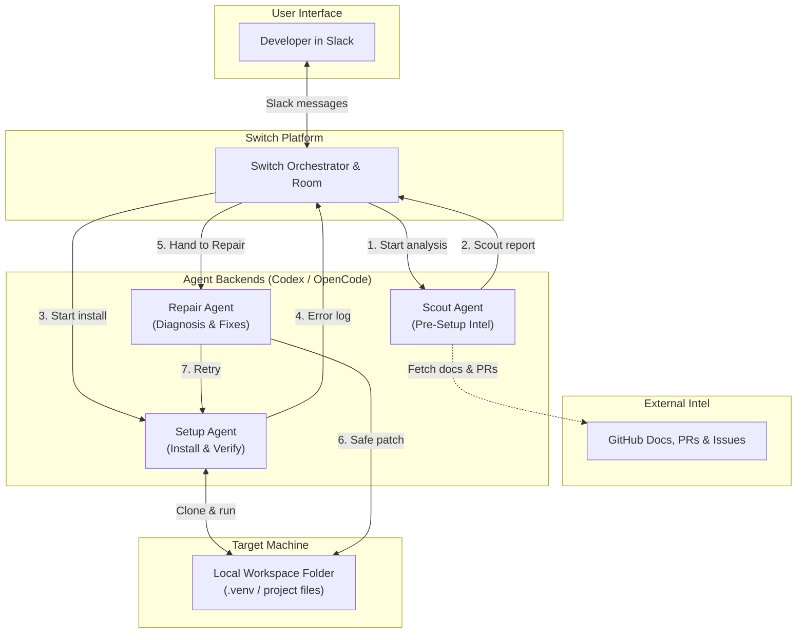

# System Architecture

Setup Desk is a multi-agent workflow that runs via [Switch](https://github.com/sandbox-quantum/switch) and Slack. It coordinates three agents powered by Codex and OpenCode to clone, investigate, set up, and repair repositories locally.

---

## Architecture Diagram

---

## The Pieces

### 1. Slack (User Interface)
No custom web portal needed. You submit repo links directly in a Slack channel, and Setup Desk posts status updates, error warnings, and the finished `SETUP.md` directly into the thread.

### 2. Switch (The Orchestrator)
[Switch](https://github.com/sandbox-quantum/switch) coordinates everything:
- Manages the shared room context between the agents.
- Routes data when one agent finishes and the next takes over.
- Enforces the 3-retry limit when errors happen.
- Connects Slack to the local workspace.

### 3. Codex & OpenCode (Agent Backends)
Connected models that handle reading code, running commands, and diagnosing errors.

### 4. Local Workspace (Target Directory)
An isolated directory on the machine where code is cloned and virtual environments are created. Agents never work outside this folder.

---

## How Data Moves Between Agents

1. **User $\rightarrow$ Scout:** Repo link and target OS information.
2. **Scout $\rightarrow$ Setup:** Scout report with prerequisites, package managers, and flagged PR fixes.
3. **Setup $\rightarrow$ Repair (on error):** Exact failed command, exit code, and terminal stderr.
4. **Repair $\rightarrow$ Setup (after fix):** Explanation of what was changed and which command to retry.
5. **Setup $\rightarrow$ Slack:** The verified `SETUP.md` and a summary of what worked.
