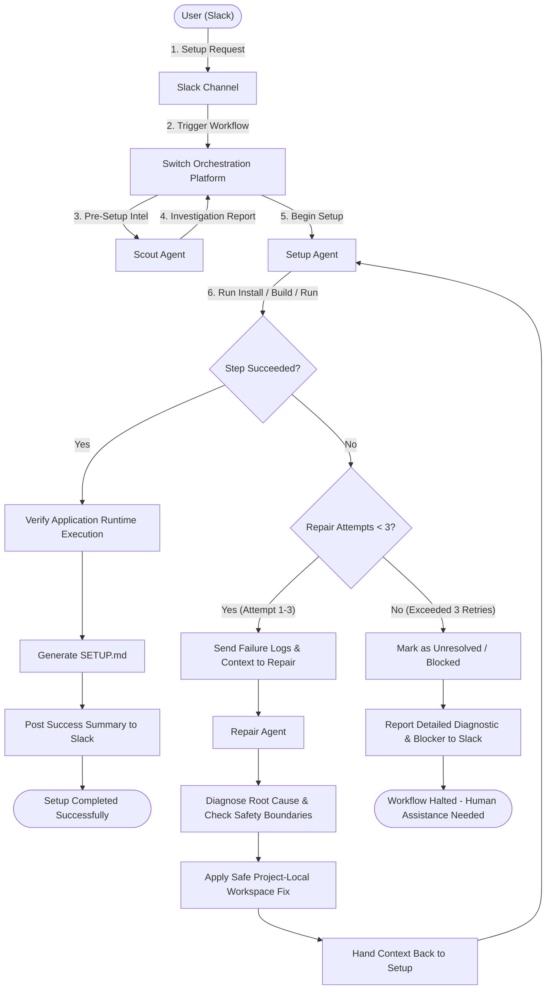
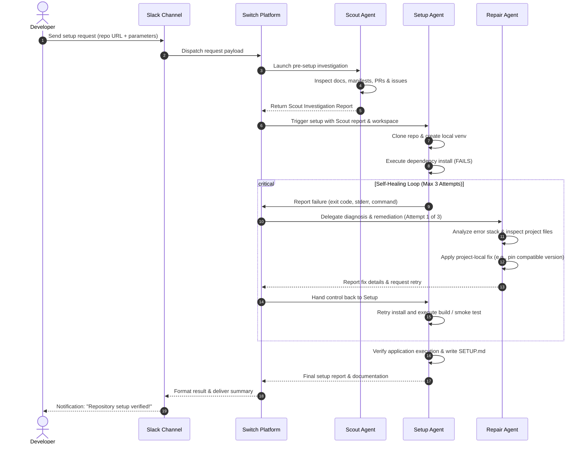

# Workflow: Self-Healing Recovery Loop

The **Self-Healing Recovery Workflow** is the primary differentiator of Setup Desk. Instead of terminating when a command fails or requiring the developer to parse esoteric stack traces, Setup Desk engages a closed-loop diagnosis and remediation cycle coordinated by [Switch](https://github.com/sandbox-quantum/switch).

---

## Complete Self-Healing Flowchart

---

## Communication Sequence Diagram

The interaction sequence between the user, Slack, Switch, and the three agents:

---

## Detailed Step-by-Step Breakdown

### 1. Trigger Conditions
The self-healing cycle is triggered immediately upon any non-zero exit code or explicit fatal error during:
- Dependency resolution or installation (e.g., pip wheels failing to compile, npm package conflicts).
- Build compilation or asset bundling.
- Configuration loading (e.g., missing expected environment files).
- Runtime verification (e.g., application crashes on startup).

### 2. Error Information Captured
Setup packages a diagnostic bundle into the Switch room:
- Command line string executed.
- Complete stdout and stderr streams.
- Working directory file path.
- Host environment context (OS, architecture, shell).
- Relevant project configuration files.

### 3. Repair Diagnosis
The [Repair agent](../agents/repair.md) analyzes the failure:
- Distinguishes between transient glitches, configuration oversights, and dependency incompatibilities.
- Checks against known workarounds identified earlier in Scout's investigation report.
- Verifies that any proposed correction falls strictly within the project directory.

### 4. Safe Remediation
Repair applies minimal, project-local modifications:
- Updates a pinned version in `requirements.txt` or `package.json`.
- Creates a local `.env` configuration file from an existing template.
- Adjusts build flags or compatibility settings.

### 5. Handoff & Retry
Repair logs what changed and why, then hands control back to Setup. Setup executes the retry, picking up from the point of failure.

### 6. The 3-Attempt Retry Boundary
Setup Desk strictly enforces a limit of **three repair attempts per failure sequence**.
- If after 3 attempts the failure persists, Setup Desk halts.
- It delivers a comprehensive breakdown to the developer in Slack explaining the root cause, what fixes were attempted, and why human intervention or system-level administrative action is required.

