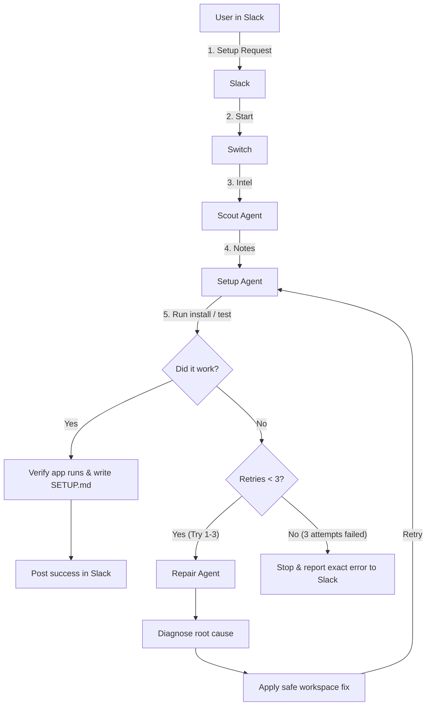
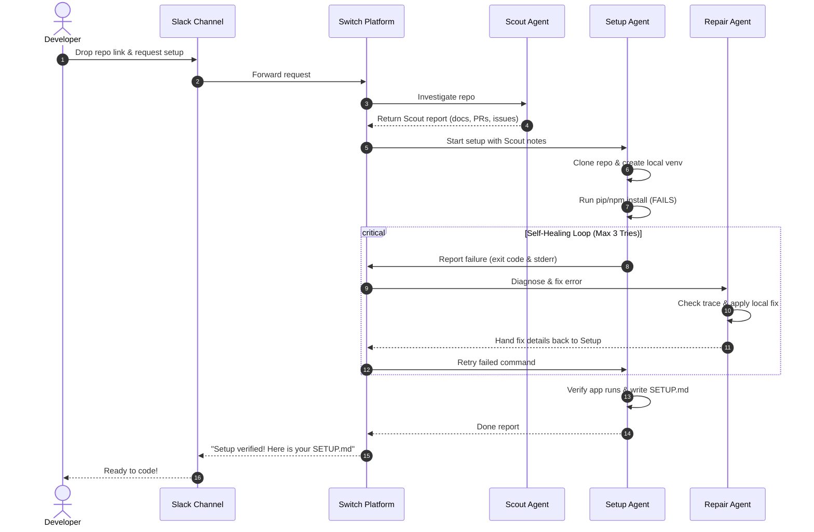

# Self-Healing Recovery Workflow

The self-healing loop is Setup Desk's main feature. When an install or build fails, Setup Desk doesn't just crash. It diagnoses what broke, fixes it locally, and retries.

---

## Flowchart

---

## Communication Sequence

---

## How It Recovers

1. **Failure happens:** An install fails (e.g. pinned dependency incompatible with your Python/Node version, or missing `.env`).
2. **Error passed to Repair:** Setup grabs the failed command and stderr log and hands them to Repair in Switch.
3. **Repair checks root cause:** Repair looks at the error and checks if Scout flagged an issue for this.
4. **Safe local patch:** Repair fixes the local file (like updating a version constraint or copying `.env.example` to `.env`).
5. **Setup retries:** Setup re-runs the command. If it passes, it moves on to testing and verification.
6. **Hard cap of 3 tries:** If the issue still isn't fixed after 3 repair attempts, the workflow stops and tells the developer in Slack what went wrong and what needs human attention.
