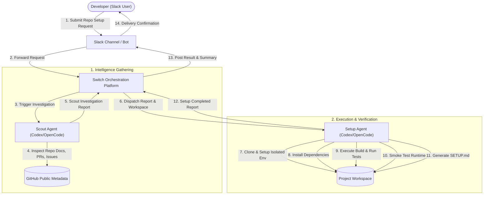

# Workflow: Standard Setup Path

The **Standard Setup Workflow** represents the clean execution path when an open-source repository installs and verifies without fatal errors.

---

## High-Level Flowchart

---

## Detailed Step-by-Step Sequence

### Phase 1: Request Ingestion & Intelligence Gathering
1. **Request Submission**:
   The developer sends a setup request in Slack:
   > *"Set up https://github.com/pallets/flask in my workspace. Investigate known setup issues first, install dependencies, run the project, and recover from safe setup failures if necessary."*
2. **Switch Orchestration**:
   The Switch platform ingests the Slack message, initialises a coordinated execution room, and invokes the [Scout agent](../agents/scout.md).
3. **Pre-Setup Analysis**:
   Scout evaluates repository structure, detects language versions and package managers, reviews setup documentation, and inspects public issues and PRs for known setup blockers.
4. **Report Handoff**:
   Scout writes a structured **Scout Investigation Report** and posts it to the Switch room.

### Phase 2: Environment Provisioning & Installation
5. **Setup Dispatch**:
   Switch triggers the [Setup agent](../agents/setup.md), supplying Scout's report and the assigned workspace path.
6. **Workspace Isolation**:
   Setup clones the repository into the dedicated workspace folder and creates a project-local virtual environment (e.g., Python `venv`).
7. **Dependency Installation**:
   Setup executes the recommended package manager commands (e.g., `pip install -e .[dev]` or `npm install`) within the virtual environment.

### Phase 3: Build, Testing, and Runtime Verification
8. **Build & Test Validation**:
   Setup runs required build commands and executes the test suite (e.g., `pytest`).
9. **Runtime Execution Verification**:
   Setup performs an active runtime check (e.g., invoking the CLI tool or executing a dry-run server startup) to verify that the application actually boots and functions.
10. **Documentation Generation**:
    Setup authors a concise, definitive [`SETUP.md`](../agents/setup.md#verification-and-final-deliverable-setupmd) in the project root, logging verified commands and configuration instructions.

### Phase 4: User Notification
11. **Completion Notification**:
    Setup posts its final report back through Switch, which formats and delivers a summary message to the developer in Slack with a link or snippet of the verified `SETUP.md`.

