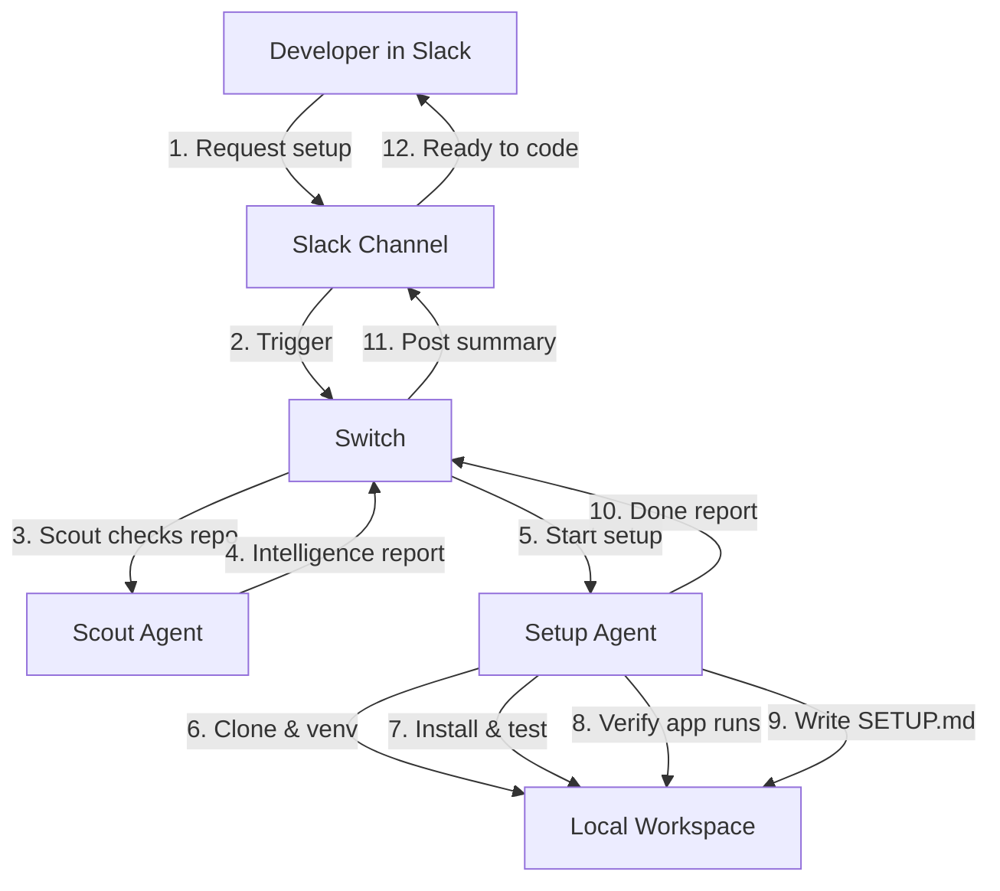

# Standard Setup Workflow

This is what happens when a repository sets up cleanly without errors.

---

## Flowchart

---

## Step-by-Step

1. **Request in Slack:** You drop a link:  
   `@SetupDesk Set up https://github.com/pallets/flask in my workspace.`
2. **Scout gathers intel:** Switch launches [Scout](../agents/scout.md). Scout checks the README, package manager, and searches GitHub issues/PRs for known setup bugs.
3. **Setup runs:** Switch launches [Setup](../agents/setup.md) with Scout's notes. Setup clones the repo into a clean folder, creates a `.venv`, and installs dependencies.
4. **Setup verifies:** Runs test suites (`pytest` or `npm test`) and makes sure the CLI or server can launch.
5. **Documentation & Slack message:** Setup writes a clean `SETUP.md` with verified commands, and Switch notifies you in Slack with the instructions.
